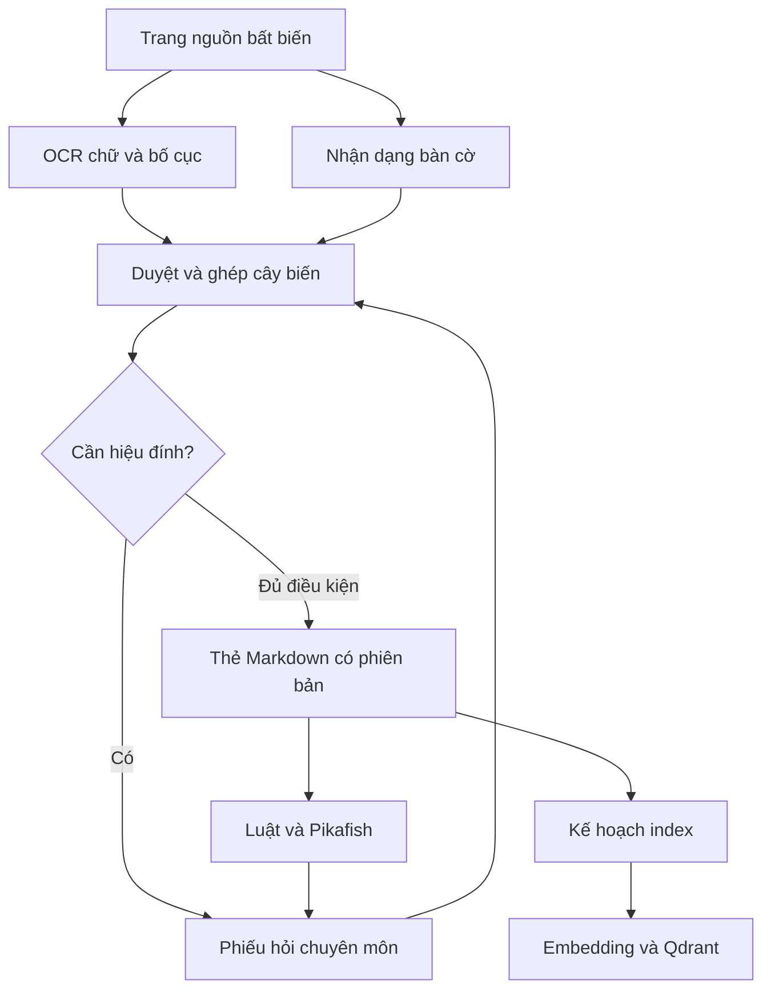

# Kiến trúc

## Nguồn và dữ liệu dẫn xuất

Markdown có ID ổn định là nguồn của nội dung do người biên tập viết. Tài sản gốc (PDF, ảnh, kỳ phổ, OCR raw) bất biến, lưu kho riêng cùng hash. Git lưu thẻ được phép công khai và các thay đổi code; corpus cá nhân dùng repo/kho riêng.

Manifest, embedding, Qdrant và cache engine là dữ liệu dẫn xuất. Mỗi kết quả có phiên bản đầu vào; không dùng ID record đơn lẻ làm cache key.

Sơ đồ thể hiện đích kiến trúc; bootstrap chỉ triển khai thẻ, validation và kế hoạch index.

## Code hiện có

- `crates/knowledge`: record model, Markdown parser, cấu trúc FEN, corpus/reference validation, index-plan. Không network, không subprocess.
- `apps/xqt`: đọc đối số, IO tệp và stdout/stderr. Lỗi typed ở thư viện; CLI exit 2 khi input không đạt.
- `knowledge/examples`: corpus minh họa tự soạn; một claim supported/approved và một heuristic draft.
- `config`: dịch vụ vector tùy chọn; chưa có consumer live.

## Các cổng cần bổ sung khi có consumer

Document/OCR/BoardRecognition, RuleReplay, EngineAnalysis, EvidenceStore, Embedding, VectorIndex và TutorRetrieval. Không tạo crate rỗng cho từng cổng ở bootstrap. Python/model có thể chạy trong worker riêng; Rust điều phối và kiểm tra contract, không bắt buộc viết lại model thành Rust.

## Giới hạn tin cậy

- OCR confidence là độ tin của model, không là bằng chứng quân đúng.
- FEN validator chỉ kiểm tra cấu trúc, không chứng minh reachability hay luật.
- Review `approved` hiện là metadata tác giả khai báo, không chữ ký xác thực danh tính.
- Evidence reference/hash hiện được kiểm tra định dạng; chưa mở artifact để chứng thực nội dung.
- Lean kernel_checked không là giá trị tác giả được khai báo trong schema v1.
- Markdown và source quote là dữ liệu không tin cậy; không thực thi predicate hoặc lệnh xuất hiện trong sách.

## Thay đổi và lỗi

Mỗi dependency pin ID + revision + SHA-256 toàn bộ Markdown bytes. Đổi body hay metadata đều làm snapshot cũ fail; không xuất một phần corpus bị stale. Hệ thống tương lai phải giữ bản index đang phục vụ, dựng generation mới, kiểm tra rồi đổi alias; việc đổi atom, nguồn hoặc thế phải phát invalidation theo dependency DAG.

Quan hệ tranh luận không tự trở thành tiền đề chứng minh. Hai claim có thể challenges nhau. Nếu dùng claim B để dẫn xuất A, A phải pin snapshot B trong dependencies.
